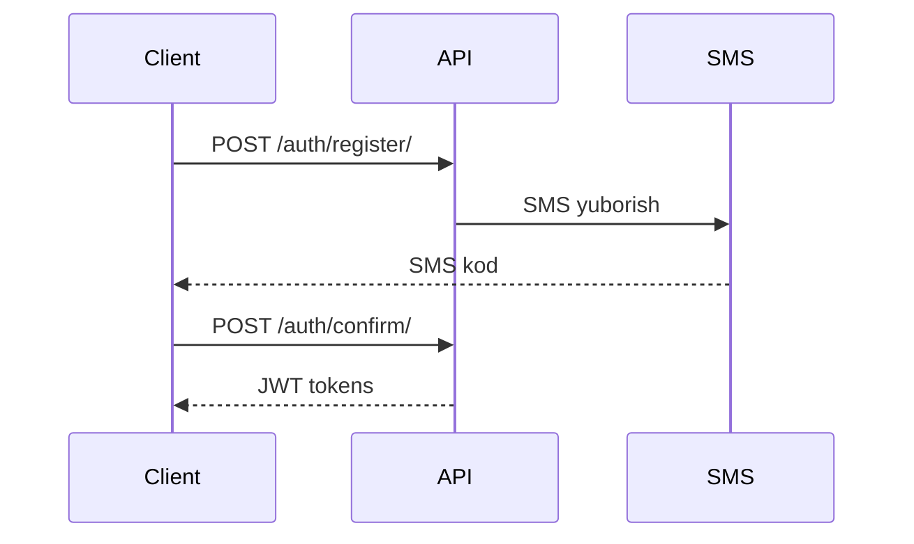
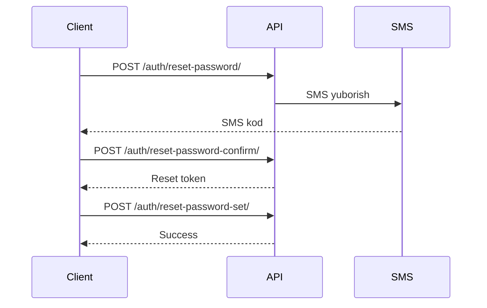

# Autentifikatsiya va Avtorizatsiya

## JWT (JSON Web Token)

BotMother API JWT (JSON Web Token) asosida autentifikatsiya qiladi.

### Token turlari

#### 1. Access Token
- **Maqsad:** API so'rovlarini autentifikatsiya qilish
- **Muddati:** 1 soat (default)
- **Ishlatish:** Har bir protected endpoint'ga so'rov yuborishda

#### 2. Refresh Token
- **Maqsad:** Access token'ni yangilash
- **Muddati:** 7 kun (default)
- **Ishlatish:** Access token muddati tugaganda

---

## Autentifikatsiya oqimi

### 1. Ro'yxatdan o'tish oqimi



**Qadamlar:**

1. **Register:** Foydalanuvchi ma'lumotlarini yuborish
   ```bash
   curl -X POST http://localhost:8081/auth/register/ \
     -H "Content-Type: application/json" \
     -d '{
       "phone": "+998901234567",
       "first_name": "Ism",
       "last_name": "Familiya",
       "password": "qwerty123"
     }'
   ```

2. **Confirm:** SMS kodni tasdiqlash
   ```bash
   curl -X POST http://localhost:8081/auth/confirm/ \
     -H "Content-Type: application/json" \
     -d '{
       "phone": "+998901234567",
       "code": "1234"
     }'
   ```

3. **Token olish:** Javobda access va refresh token qaytariladi
   ```json
   {
     "detail": "Tasdiqlash ko'di qabul qilindi",
     "token": {
       "access": "eyJhbGc...",
       "refresh": "eyJhbGc..."
     }
   }
   ```

---

### 2. Login oqimi

```bash
curl -X POST http://localhost:8081/auth/token/ \
  -H "Content-Type: application/json" \
  -d '{
    "phone": "+998901234567",
    "password": "qwerty123"
  }'
```

**Javob:**
```json
{
  "access": "eyJhbGc...",
  "refresh": "eyJhbGc..."
}
```

---

### 3. Token bilan so'rov yuborish

Har bir protected endpoint'ga so'rov yuborishda `Authorization` header qo'shish kerak:

```bash
curl -X GET http://localhost:8081/auth/me/ \
  -H "Authorization: Bearer eyJhbGc..."
```

---

### 4. Token yangilash

Access token muddati tugaganda:

```bash
curl -X POST http://localhost:8081/auth/token/refresh/ \
  -H "Content-Type: application/json" \
  -d '{
    "refresh": "eyJhbGc..."
  }'
```

**Javob:**
```json
{
  "access": "yangi_access_token"
}
```

---

## Parolni tiklash oqimi



**Qadamlar:**

1. **Reset so'rovi**
   ```bash
   curl -X POST http://localhost:8081/auth/reset-password/ \
     -H "Content-Type: application/json" \
     -d '{"phone": "+998901234567"}'
   ```

2. **Kodni tasdiqlash**
   ```bash
   curl -X POST http://localhost:8081/auth/reset-password-confirm/ \
     -H "Content-Type: application/json" \
     -d '{
       "phone": "+998901234567",
       "code": "1234"
     }'
   ```

3. **Yangi parol o'rnatish**
   ```bash
   curl -X POST http://localhost:8081/auth/reset-password-set/ \
     -H "Content-Type: application/json" \
     -d '{
       "token": "reset-token-uuid",
       "password": "yangi_parol"
     }'
   ```

---

## Telegram autentifikatsiya

Telegram Login Widget orqali autentifikatsiya:

```bash
curl -X POST http://localhost:8081/authbot/login/ \
  -H "Content-Type: application/json" \
  -d '{
    "id": 123456789,
    "first_name": "John",
    "username": "john_doe",
    "auth_date": 1234567890,
    "hash": "telegram-widget-hash"
  }'
```

**Frontend integration (HTML):**
```html
<script async src="https://telegram.org/js/telegram-widget.js?22" 
        data-telegram-login="your_bot_username" 
        data-size="large" 
        data-auth-url="http://localhost:8081/authbot/login/"
        data-request-access="write">
</script>
```

---

## Xatoliklar

### 401 Unauthorized

**Sabablari:**
- Token berilmagan
- Token noto'g'ri
- Token muddati tugagan

**Yechim:**
```javascript
// Token muddati tugagan bo'lsa, refresh qiling
async function refreshToken() {
  const response = await fetch('http://localhost:8081/auth/token/refresh/', {
    method: 'POST',
    headers: {
      'Content-Type': 'application/json'
    },
    body: JSON.stringify({
      refresh: localStorage.getItem('refresh_token')
    })
  });
  
  const data = await response.json();
  localStorage.setItem('access_token', data.access);
}
```

### 403 Forbidden

**Sabablari:**
- Ruxsat yo'q
- Noto'g'ri parol
- Noto'g'ri SMS kod

---

## Best Practices

### 1. Token saqlash

**Browser (Frontend):**
```javascript
// Access token - localStorage
localStorage.setItem('access_token', token.access);

// Refresh token - httpOnly cookie (xavfsizroq)
// yoki localStorage (oddiyroq)
localStorage.setItem('refresh_token', token.refresh);
```

**Mobile (React Native):**
```javascript
import AsyncStorage from '@react-native-async-storage/async-storage';

await AsyncStorage.setItem('access_token', token.access);
await AsyncStorage.setItem('refresh_token', token.refresh);
```

### 2. Automatic token refresh

```javascript
// Axios interceptor misoli
axios.interceptors.response.use(
  response => response,
  async error => {
    const originalRequest = error.config;
    
    if (error.response.status === 401 && !originalRequest._retry) {
      originalRequest._retry = true;
      
      const refreshToken = localStorage.getItem('refresh_token');
      const response = await axios.post('/auth/token/refresh/', {
        refresh: refreshToken
      });
      
      localStorage.setItem('access_token', response.data.access);
      
      originalRequest.headers['Authorization'] = 
        'Bearer ' + response.data.access;
      
      return axios(originalRequest);
    }
    
    return Promise.reject(error);
  }
);
```

### 3. Token tekshirish

So'rov yuborishdan oldin token borligini tekshiring:

```javascript
function getAuthHeader() {
  const token = localStorage.getItem('access_token');
  
  if (!token) {
    throw new Error('No authentication token found');
  }
  
  return {
    'Authorization': `Bearer ${token}`,
    'Content-Type': 'application/json'
  };
}
```

### 4. Logout

```javascript
function logout() {
  localStorage.removeItem('access_token');
  localStorage.removeItem('refresh_token');
  // Redirect to login page
  window.location.href = '/login';
}
```

---

## Security Considerations

### ✅ DO (Qiling)

1. **HTTPS ishlatish** (production'da)
2. **Token'larni xavfsiz saqlash** (httpOnly cookies)
3. **Token muddatini tekshirish**
4. **Refresh token'ni xavfsiz saqlash**
5. **Logout qilganda token'larni o'chirish**

### ❌ DON'T (Qilmang)

1. **Token'ni URL'da yuborish**
2. **Token'ni console.log qilish**
3. **Token'ni localStorage'da plaintext saqlash (mobilda)**
4. **Bir xil token'ni ko'p qurilmada ishlatish**
5. **Token muddatini tekshirmaslik**

---

## Rate Limiting

Autentifikatsiya endpoint'lariga rate limiting qo'llaniladi:

| Endpoint | Limit | Davr |
|----------|-------|------|
| `/auth/register/` | 5 | 1 soat |
| `/auth/confirm/` | 10 | 1 soat |
| `/auth/resend/` | 5 | 1 soat |
| `/auth/token/` | 20 | 1 soat |
| `/auth/reset-password/` | 5 | 1 soat |

Rate limit oshganda `429 Too Many Requests` xatosi qaytariladi.

---

## Testing

### Postman

1. **Environment o'rnatish:**
   ```json
   {
     "base_url": "http://localhost:8081",
     "access_token": "",
     "refresh_token": ""
   }
   ```

2. **Pre-request script (avtomatik token qo'shish):**
   ```javascript
   pm.request.headers.add({
     key: 'Authorization',
     value: 'Bearer ' + pm.environment.get('access_token')
   });
   ```

3. **Tests (token saqlash):**
   ```javascript
   if (pm.response.code === 200) {
     const response = pm.response.json();
     if (response.access) {
       pm.environment.set('access_token', response.access);
     }
     if (response.refresh) {
       pm.environment.set('refresh_token', response.refresh);
     }
   }
   ```

---

## FAQ

### Token muddati qancha?

- **Access token:** 1 soat
- **Refresh token:** 7 kun

### Token'ni qanday decode qilish mumkin?

```javascript
function parseJwt(token) {
  const base64Url = token.split('.')[1];
  const base64 = base64Url.replace(/-/g, '+').replace(/_/g, '/');
  const jsonPayload = decodeURIComponent(
    atob(base64).split('').map(c => 
      '%' + ('00' + c.charCodeAt(0).toString(16)).slice(-2)
    ).join('')
  );
  
  return JSON.parse(jsonPayload);
}

const decoded = parseJwt(accessToken);
console.log('User ID:', decoded.user_id);
console.log('Expires at:', new Date(decoded.exp * 1000));
```

### Refresh token ham muddati tugasa nima qilish kerak?

Foydalanuvchini qayta login qilish kerak.

### Bir nechta qurilmada ishlash mumkinmi?

Ha, har bir qurilma o'z token'iga ega bo'lishi mumkin.
